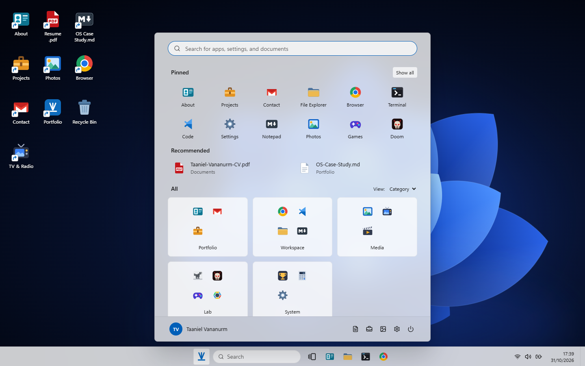
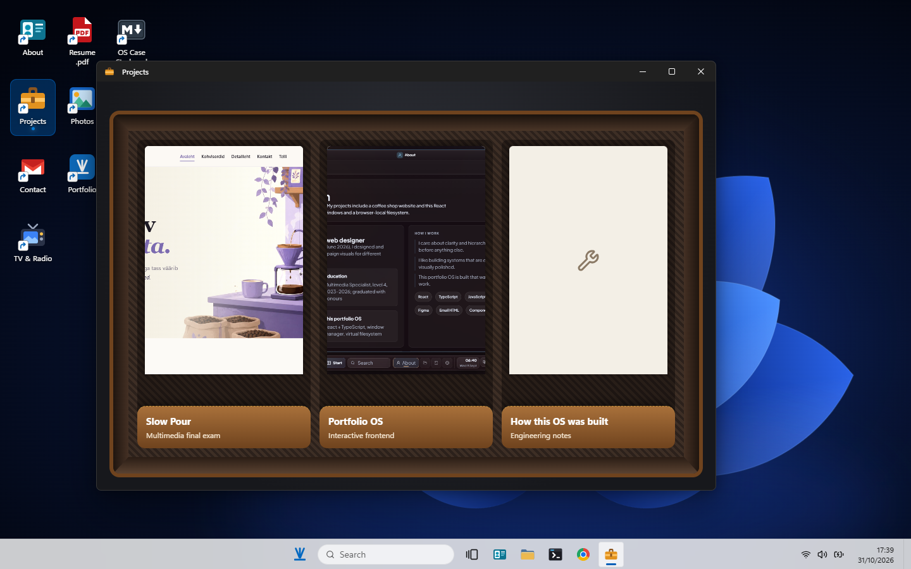
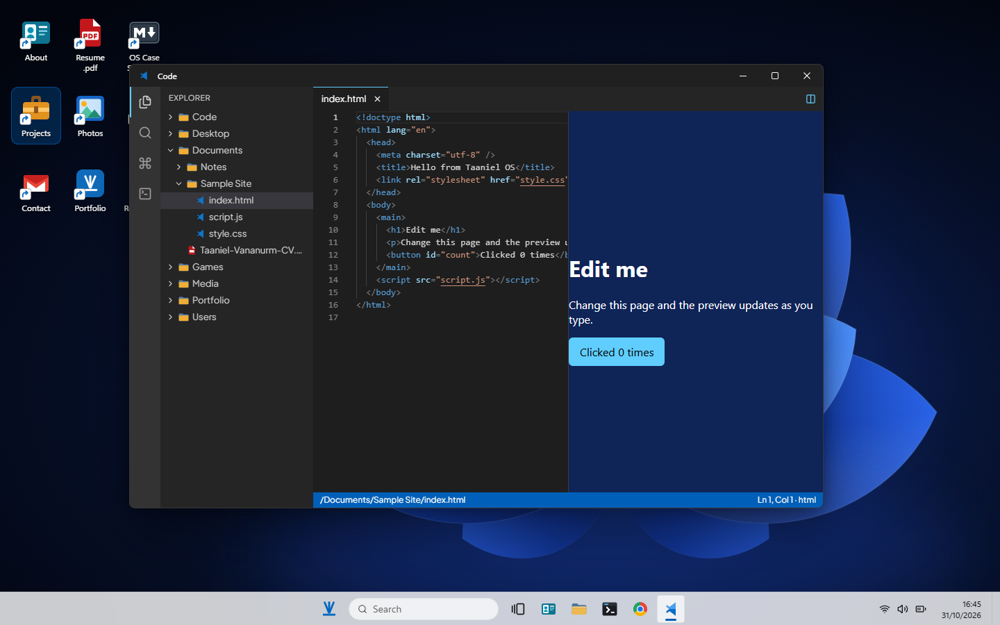
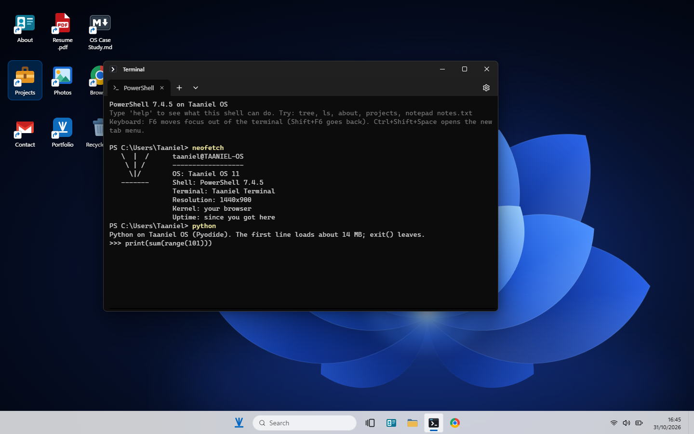
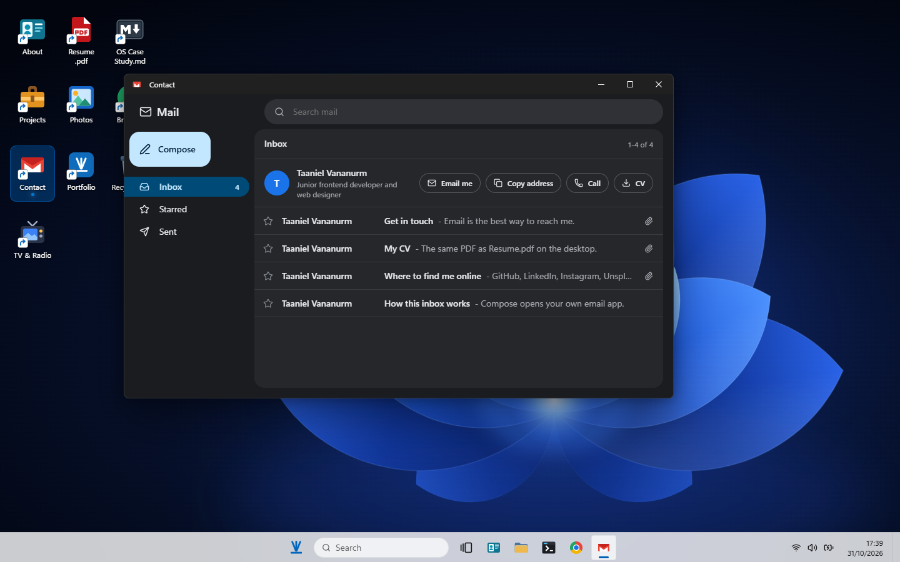
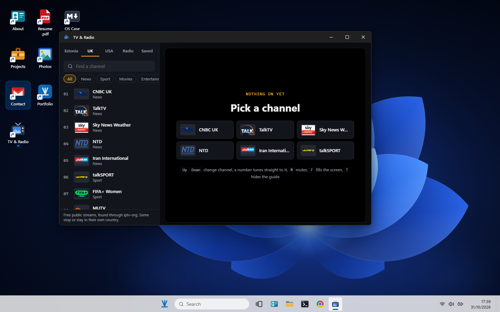
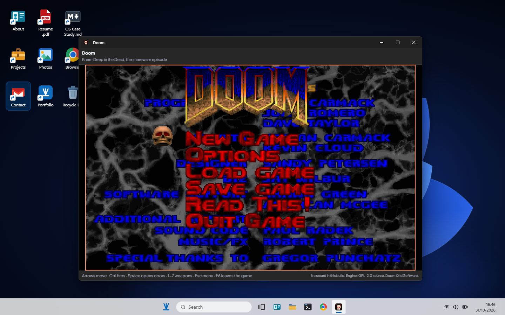
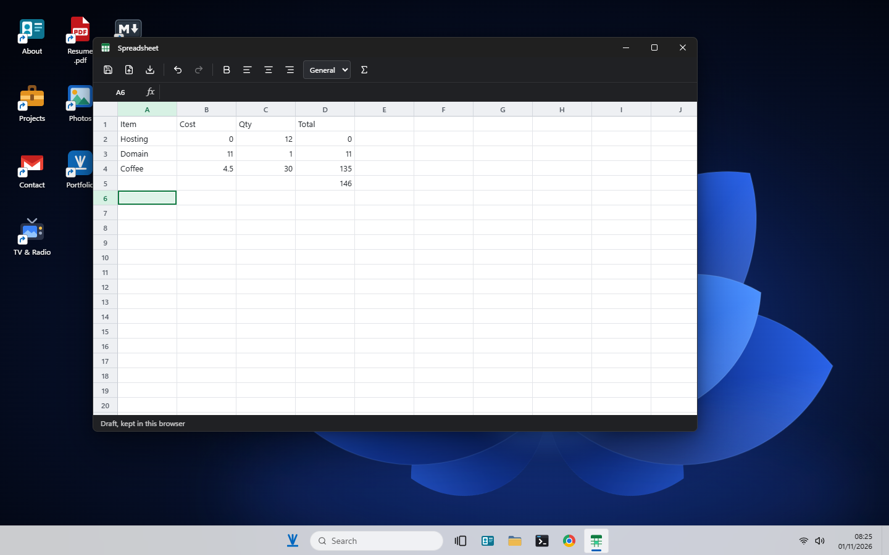
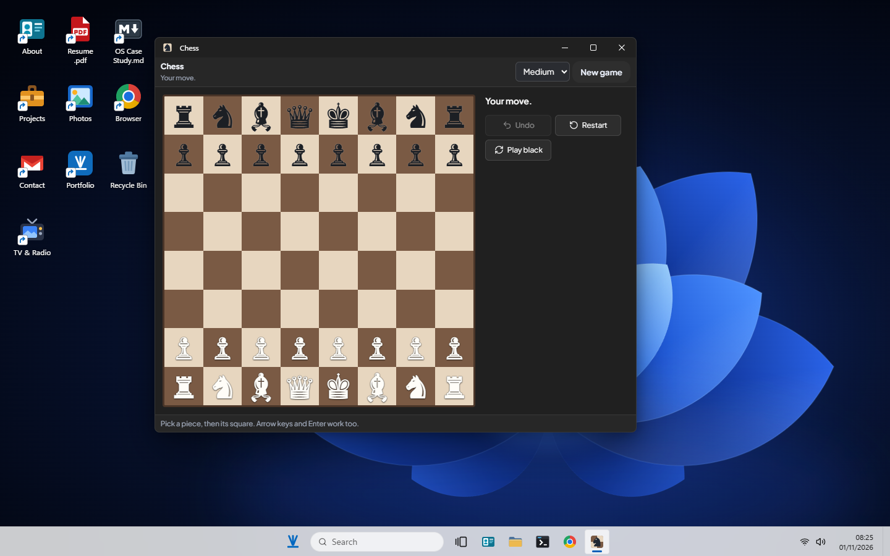

# Taaniel OS

A desktop operating system that runs in your browser, built as the portfolio of Taaniel Vananurm.

Files are real files on a virtual disk, windows snap and move between desktops, and the big apps use real engines: Python, a Linux kernel, Doom and the Monaco editor. There is no server and no account. It all runs on GitHub Pages.

**[Try it live](https://taan1el.github.io/taaniel-portfolio-os/)** · [Quick portfolio](https://taan1el.github.io/taaniel-portfolio-os/portfolio/) · [Download CV](https://taan1el.github.io/taaniel-portfolio-os/assets/CV_Taaniel_Vananurm_EN.pdf)

<p align="center">
  <a href="https://taan1el.github.io/taaniel-portfolio-os/">
    
  </a>
</p>

## What's inside

| | |
| --- | --- |
|  |  |
| **Projects** opens like a briefcase, with a pocket for each project | **Code** is Monaco with tabs, search and a live preview |
|  |  |
| **Terminal** has two hand-written shells, plus real Python | **Contact** is an inbox with one-click email, phone and CV |
|  |  |
| **TV & Radio** has 88 live channels from Estonia, the UK and the USA, plus ERR radio and what's on now | **Doom** runs as WebAssembly |
|  |  |
| **Spreadsheet** has its own formula engine, with no eval | **Chess** knows every rule and plays back |

Also on board:

- **File Explorer** with tabs, a preview pane, Properties, drag and drop, shortcuts and a Recycle Bin
- **Windows** with Snap Layouts, virtual desktops, Task View, a Task Manager and a Run dialog
- **Linux** running on an x86 emulator
- **Settings** with search, accent colours, clock formats, do not disturb and default apps
- **Documents, Spreadsheet, Whiteboard and Calendar**
- **Notepad, Notes, Paint, Calculator, Photos, Music and Video**
- **Games**: Doom, Next Stop, Chess, Sudoku, Checkers, Solitaire, Dino, Hextris, Snake and Tetris

## Run it yourself

```bash
npm install
npm run dev
```

| Command | What it does |
| --- | --- |
| `npm test` | Runs the tests |
| `npm run build` | Builds for production |
| `npm run deploy:gh` | Builds and publishes to GitHub Pages |

## Built with

- **App:** React 19, TypeScript, Vite, Zustand
- **Motion and windows:** Framer Motion, GSAP, react-rnd
- **Apps:** Monaco, xterm.js, pdf.js, hls.js
- **Engines:** Pyodide (Python), v86 (Linux), Doom as WebAssembly. These download only when an app needs them.

## Project layout

| Folder | What's there |
| --- | --- |
| `src/components/shell` | Desktop, Start menu, taskbar and windows |
| `src/components/apps` | Every app |
| `src/stores` | App state |
| `src/lib` | Filesystem, shells, search and helpers |
| `src/data` | Portfolio content and the starting files |

## Good to know

- **Your data stays with you.** Everything you change is saved in your own browser. Use Start > Power > Reset this PC to clear it.
- **The Browser app is an iframe.** Many sites refuse to load inside one, so it offers to open them in a new tab instead.
- **TV streams come straight from each broadcaster.** Some programmes have no web rights, and some channels only open in their own country.
- **Two scheduled jobs look after TV.** One flags channels that stop playing in a GitHub issue. The other refreshes what's on now from public listings. A channel with no listing shows no programme name.

## More docs

[Architecture](docs/ARCHITECTURE.md) · [Roadmap](docs/ROADMAP.md) · [Adding an app](docs/ADDING_AN_APP.md) · [Performance](docs/PERFORMANCE.md) · [Releasing](docs/RELEASE.md) · [Maintenance](docs/MAINTENANCE.md) · [Next Stop](docs/next-stop.md) · [Contributing](CONTRIBUTING.md)
